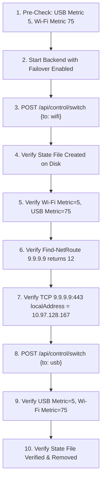

# NetSwitch Phase 6 Stage 5A: Physical Failover Preflight Report

**Audit Date:** 2026-11-08T20:12:45+05:30  
**Host Environment:** Lenovo Legion 5 (Windows 11 Home, Node.js v24.14.0, Native MySQL 8.0)  
**Branch:** `development` (Clean working tree, zero commits, zero pushes)  
**Safety Flags:** `NETSWITCH_FAILOVER_ENABLED=false`, `NETSWITCH_PROBE_ROUTE_PINNING=false`  
**Overall Verdict:** **READY FOR CONTROLLED MANUAL FAILOVER (STAGE 5B)**  

---

## 1. Executive Summary

This preflight audit validates the physical hardware, Windows routing configuration, safety hardening architecture, and emergency recovery mechanisms in preparation for NetSwitch's first controlled physical interface failover test.

All findings confirm that the system is in a stable, verified, and safe state:
1. Both physical network adapters (`Ethernet 2` / USB Tethering and `Wi-Fi` / Intel AX203) are connected, up, and actively routing traffic to their respective default gateways.
2. Virtual adapters (VMware VMnet1, VMware VMnet8, Wi-Fi Direct, and Loopback) are strictly excluded from NetSwitch discovery and controller management.
3. Zero stale `/32` probe routes exist in the Windows routing table.
4. `netswitch-state.json` is completely absent on disk, indicating no residual or unverified switch state.
5. Both safety flags remain explicitly `false`.
6. Emergency recovery scripts ([`scripts/restore.ps1`](file:///d:/TY%20(5th%20Sem)/CNT/CP/NetSwitch/scripts/restore.ps1) and [`restore.ps1`](file:///d:/TY%20(5th%20Sem)/CNT/CP/NetSwitch/restore.ps1)) have been audited and verified 100% compatible with the fail-closed Stage 4B.1 corrections.
7. A precise, step-by-step test plan for Phase 6 Stage 5B (Controlled Manual Switch & Rollback) is defined with strict stop conditions and manual fallback procedures.

---

## 2. Current Physical Adapter Inventory

The active network adapters on the host were audited via `Get-NetAdapter`, `Get-NetIPInterface`, and NetSwitch's Windows discovery module ([`backend/src/windows/discovery.js`](file:///d:/TY%20(5th%20Sem)/CNT/CP/NetSwitch/backend/src/windows/discovery.js)):

| Attribute | Primary Adapter (USB Tethering) | Secondary Adapter (Wi-Fi) |
| :--- | :--- | :--- |
| **Interface Alias** | `Ethernet 2` | `Wi-Fi` |
| **NetSwitch ID** | `usb` | `wifi` |
| **Classification** | `usb` (Eligible) | `wifi` (Eligible) |
| **Interface Index** | `17` | `12` |
| **Operational Status** | **Up** | **Up** |
| **Hardware Device** | Remote NDIS based Internet Sharing Device | Intel(R) Wi-Fi 6 AX203 160MHz |
| **MAC Address** | `22-FF-A1-84-B8-38` | `6C-2F-80-26-39-2D` |
| **Interface GUID** | `{ABF70CB2-CDCA-4772-BFC0-3B52CC87C14E}` | `{79D3B1F2-252B-4E2C-ADF8-1F0379A04DD9}` |
| **PnP Device ID** | `USB\VID_22B8&PID_2E24&MI_00\6&2a87ca6c&0&0000` | `PCI\VEN_8086&DEV_7A70&SUBSYS_02748086&REV_11\...` |
| **IPv4 Address** | `10.41.171.54 / 24` | `10.97.128.167 / 24` |
| **Default Gateway** | `10.41.171.250` | `10.97.128.135` |
| **Gateway Reachability** | **0% loss, <1 ms RTT** | **0% loss, 1 ms RTT** |
| **InterfaceMetric** | **5** (`AutomaticMetric: Disabled`) | **75** (`AutomaticMetric: Disabled`) |
| **RouteMetric (0.0.0.0/0)** | **5** (Effective Metric = **10**) | **75** (Effective Metric = **150**) |

---

## 3. Exclusion of Virtual and VMware Adapters

Audited all non-physical and virtual network interfaces on the host:

| Adapter Name | Index | Type / Description | Exclusion Status | NetSwitch Enforcement |
| :--- | :--- | :--- | :--- | :--- |
| `VMware Network Adapter VMnet1` | `21` | VMware Host-Only Virtual Adapter | **EXCLUDED** | Filtered by regex `/VMware/` in `isVirtualOrExcluded()`; rejected by `assertEligible()`. |
| `VMware Network Adapter VMnet8` | `15` | VMware NAT Virtual Adapter | **EXCLUDED** | Filtered by regex `/VMware/` in `isVirtualOrExcluded()`; rejected by `assertEligible()`. |
| `Local Area Connection* 1` | `10` | Microsoft Wi-Fi Direct Virtual Adapter | **EXCLUDED** | Excluded (no default gateway, virtual device). |
| `Local Area Connection* 2` | `13` | Microsoft Wi-Fi Direct Virtual Adapter #2 | **EXCLUDED** | Excluded (no default gateway, virtual device). |
| `Loopback Pseudo-Interface 1` | `1` | Software Loopback Interface | **EXCLUDED** | Excluded (loopback). |
| `Ethernet` | `5` | Realtek PCIe GbE Family Controller | **EXCLUDED** | Excluded (`Status: Disconnected`, no IP/gateway). |

**Confirmation:** Running `discoverWindows()` returns **only** `usb` (Index 17) and `wifi` (Index 12). Zero virtual or VMware adapters appear in NetSwitch's managed adapter list.

---

## 4. Routing Table & State Verification

1. **IPv4 Default Routes (`0.0.0.0/0`):**
   ```
   DestinationPrefix NextHop       RouteMetric InterfaceIndex InterfaceAlias
   ----------------- -------       ----------- -------------- --------------
   0.0.0.0/0         10.41.171.250           5             17 Ethernet 2    
   0.0.0.0/0         10.97.128.135          75             12 Wi-Fi         
   ```
   - Primary default route: `Ethernet 2` (Total effective metric 10)
   - Secondary standby route: `Wi-Fi` (Total effective metric 150)
   - Persistent routes: **None**

2. **Probe `/32` Route Check:**
   - Queried `Get-NetRoute -DestinationPrefix '*/32'`.
   - Result: Only standard Windows broadcast (`255.255.255.255/32`), loopback (`127.0.0.1/32`), and local interface IP self-routes (`10.41.171.54/32`, `10.97.128.167/32`, etc.) exist.
   - **Zero temporary `/32` probe routes** (`1.1.1.1`, `1.0.0.1`, `8.8.8.8`, `8.8.4.4`, `9.9.9.10`, `149.112.112.10`) exist in the routing table.

3. **State File Existence:**
   - Checked `netswitch-state.json` in workspace root.
   - Status: **Absent** (`Test-Path: False`). No unrecovered state exists.

---

## 5. Safety Configuration Verification

Checked `backend/.env` and `backend/src/config.js`:
```env
NETSWITCH_FAILOVER_ENABLED=false
NETSWITCH_PROBE_ROUTE_PINNING=false
```
- Failover decisions and metric switching remain **strictly disabled**.
- Route pinning remains **strictly disabled**.

---

## 6. Recovery Readiness & Script Compatibility Audit

The recovery procedures and scripts were audited against the Stage 4B.1 changes:

### 1. PowerShell Out-of-Band Script: [`scripts/restore.ps1`](file:///d:/TY%20(5th%20Sem)/CNT/CP/NetSwitch/scripts/restore.ps1)
- **Safe No-State Handling:** If `netswitch-state.json` does not exist, the script reports `"No state file found at $StateFile. Zero network changes made."` and exits without executing any `Remove-NetRoute` or `Set-NetIPInterface` command.
- **Fail-Closed Hardware Anchoring:** Validates `InterfaceGuid` and `MacAddress` against `Get-NetAdapter` before restoring metrics to any interface. If an adapter has been unplugged or re-indexed with a different device, restoration to that interface is refused and the state file is preserved.
- **Exact Route Deletion:** Removes only routes matching the recorded interface index and next hop (`-NextHop $p.gateway`).
- **No Destination-Only Wildcards:** All global destination-only `Remove-NetRoute` loops were permanently eliminated in Stage 4B.1.
- **Independent Verification:** Re-queries interface metrics and routes after restoration. If any mismatch is detected, the state file is retained on disk for diagnostic analysis.

### 2. Root Shortcut: [`restore.ps1`](file:///d:/TY%20(5th%20Sem)/CNT/CP/NetSwitch/restore.ps1)
- Verified delegation to `scripts/restore.ps1` with passed parameters.

### 3. Controller Crash Recovery: [`WinController.restoreFromStateFile()`](file:///d:/TY%20(5th%20Sem)/CNT/CP/NetSwitch/backend/src/control/winController.js#L574-L715)
- Includes the Startup Recovery Guard (`why === 'startup' && !this.failoverEnabled` preserves state without OS mutation).
- Includes per-interface hardware GUID/MAC verification before every metric change.
- Includes route ownership matching and independent deletion verification via `Get-NetRoute`.

---

## 7. Remaining Blockers & Pre-Test Considerations

| Item | Status | Impact / Mitigation |
| :--- | :--- | :--- |
| **1. Upstream WAN Decoupling** | **Limitation (Documented)** | Both USB tethering and Wi-Fi currently share the same Moto g64 5G cellular uplink. A metric swap validates Windows route switching, OS TCP binding, and latency re-prioritization, but does not provide multi-carrier WAN redundancy. Safe to test interface-level failover. |
| **2. Failover Safety Flag** | **Blocker (Intentional)** | `NETSWITCH_FAILOVER_ENABLED=false` blocks manual and automatic switching. To execute Stage 5B, the user must explicitly authorize enabling this flag in the test process environment. |
| **3. Administrator Elevation** | **Prerequisite** | `Set-NetIPInterface` requires an elevated process. Backend must be run in an Administrator PowerShell console. |
| **4. Probe Route Pinning** | **Disabled (Recommended)** | For the initial manual switch test, `NETSWITCH_PROBE_ROUTE_PINNING` should remain `false`. Failover should be validated cleanly without creating temporary `/32` routes. |

---

## 8. Proposed Stage 5B Test Plan: Controlled Manual Physical Failover

### Objective
Execute a controlled, transaction-safe manual metric switch from `usb` (`Ethernet 2`) to `wifi` (`Wi-Fi`), verify OS-level route and traffic migration, and cleanly switch back to `usb`.

### Prerequisites
- Elevated Administrator PowerShell terminal.
- Project root: `d:\TY (5th Sem)\CNT\CP\NetSwitch`.
- Environment override for test session only:
  ```env
  NETSWITCH_FAILOVER_ENABLED=true
  NETSWITCH_PROBE_ROUTE_PINNING=false
  ```

### Step-by-Step Execution Sequence



#### Step 1: Pre-Switch Baseline Verification
- Confirm `Ethernet 2` metric is 5, `Wi-Fi` metric is 75.
- Confirm `Find-NetRoute -RemoteIPAddress 9.9.9.9` returns interface index `17` (USB).

#### Step 2: Start Backend (Elevated, Failover Enabled)
- Run `node backend/src/index.js` with `NETSWITCH_FAILOVER_ENABLED=true`.
- Verify `/api/health` reports `canControl: true` and `failoverEnabled: true`.

#### Step 3: Trigger Controlled Manual Switch
- Send authenticated request:
  ```http
  POST /api/control/switch
  Content-Type: application/json
  Authorization: Bearer <TOKEN>

  { "to": "wifi" }
  ```

#### Step 4: Verification of Migration (While Wi-Fi is Active)
- **State File:** Verify `netswitch-state.json` exists, containing original metrics (`[ { index: 17, metric: 5 }, { index: 12, metric: 75 } ]`).
- **OS Metrics:**
  - `Wi-Fi` (Index 12) -> InterfaceMetric: `5`
  - `Ethernet 2` (Index 17) -> InterfaceMetric: `75`
- **Route Selection:**
  - Run `Find-NetRoute -RemoteIPAddress 9.9.9.9` -> Must return `12` (`Wi-Fi`).
- **Egress Verification:**
  - NetSwitch performs unbound TCP connect to `9.9.9.9:443`. Must report source address `10.97.128.167` (`Wi-Fi`).

#### Step 5: Controlled Switchback (Restore USB Priority)
- Send switchback request:
  ```http
  POST /api/control/switch
  Content-Type: application/json
  Authorization: Bearer <TOKEN>

  { "to": "usb" }
  ```
  *(Or `POST /api/control/restore`)*.

#### Step 6: Post-Switchback Verification
- `Ethernet 2` (Index 17) -> InterfaceMetric: `5`
- `Wi-Fi` (Index 12) -> InterfaceMetric: `75`
- `Find-NetRoute -RemoteIPAddress 9.9.9.9` -> Returns `17` (`Ethernet 2`).
- `netswitch-state.json` -> Verified and unlinked from disk.

---

## 9. Emergency Stop Conditions & Rollback Instructions

### Stop Conditions (Immediate Abort)
If ANY of the following occurs during the test, stop immediately:
1. `Set-NetIPInterface` returns an access denied or CIM error.
2. `queryAdapterIdentity()` fails or detects a GUID/MAC mismatch.
3. Any PowerShell command references index `15` or `21` (VMware).
4. `Find-NetRoute 9.9.9.9` does not switch to the target interface index within 3 seconds.
5. Unbound TCP verification fails.
6. Internet connectivity drops on both adapters simultaneously.

### Out-of-Band Manual Rollback Procedure
If the application crashes, hangs, or fails to restore automatically:
1. Open an elevated **Administrator PowerShell** terminal.
2. Run the recovery script:
   ```powershell
   cd 'd:\TY (5th Sem)\CNT\CP\NetSwitch'
   .\scripts\restore.ps1
   ```
3. The script will:
   - Read `netswitch-state.json`.
   - Restore `Ethernet 2` to Metric 5 (`AutomaticMetric: Disabled`).
   - Restore `Wi-Fi` to Metric 75 (`AutomaticMetric: Disabled`).
   - Independently query and verify both metrics.
   - Delete `netswitch-state.json`.
4. Verify restoration via:
   ```powershell
   Get-NetIPInterface -AddressFamily IPv4 | Where-Object { $_.InterfaceAlias -in @('Ethernet 2', 'Wi-Fi') }
   ```

---

## 10. Preflight Verdict

| Check | Verdict | Details |
| :--- | :--- | :--- |
| **Physical Adapters Connected** | **PASS** | USB (Index 17) and Wi-Fi (Index 12) both up with active gateways. |
| **Virtual Adapter Exclusion** | **PASS** | VMware VMnet1, VMnet8, Wi-Fi Direct, and Loopback completely excluded. |
| **Routing Table Hygiene** | **PASS** | Default routes intact; zero stale `/32` probe routes exist. |
| **State File Cleanliness** | **PASS** | `netswitch-state.json` absent on disk. |
| **Safety Flags Active** | **PASS** | Both flags currently `false`. |
| **Recovery Scripts Audited** | **PASS** | Fully compliant with Stage 4B.1 fail-closed architecture. |
| **Readiness for Stage 5B** | **PASS** | System is ready for controlled manual switch upon authorization. |

---

**Execution Status:** STOPPED. Awaiting explicit user authorization before executing Phase 6 Stage 5B.

